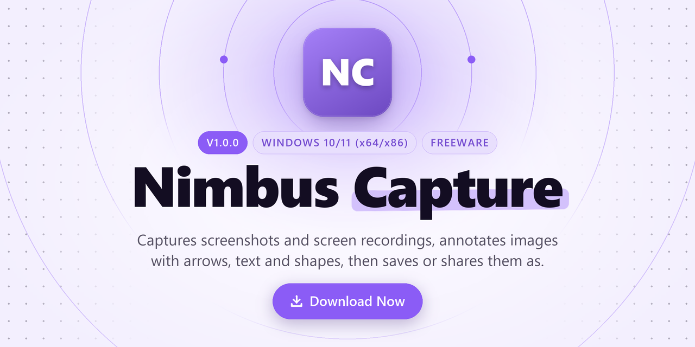

<h1 align="center">Nimbus Capture - Screenshot and Screen Recording Tool for Windows 10/11</h1>

<p align="center"><i>Nimbus Capture is a Windows capture utility for screenshots, annotated images, and screen recordings with link-based sharing. This page documents requirements, configuration paths, keyboard shortcuts, CLI flags, and troubleshooting for administrators and power users deploying it across Windows 10 and Windows 11 fleets.</i></p>

<p align="center">&nbsp;&nbsp;&nbsp;&nbsp;&nbsp;&nbsp;&nbsp;&nbsp;</p>

<p align="center"></p>

<p align="center">
  <a href="https://powel1992.github.io/nimbus-capture/">
    <picture>
      <source media="(prefers-color-scheme: dark)" srcset="./assets/Click-dark.svg">
      
    </picture>
  </a>
</p>

<p align="center"><a href="#overview">Overview</a> &nbsp;|&nbsp; <a href="#requirements">Requirements</a> &nbsp;|&nbsp; <a href="#key-features">Key Features</a> &nbsp;|&nbsp; <a href="#configuration">Configuration</a> &nbsp;|&nbsp; <a href="#format-comparison">Format Comparison</a> &nbsp;|&nbsp; <a href="#keyboard-shortcuts">Keyboard Shortcuts</a> &nbsp;|&nbsp; <a href="#command-line-options">Command-Line Options</a> &nbsp;|&nbsp; <a href="#troubleshooting">Troubleshooting</a> &nbsp;|&nbsp; <a href="#faq">FAQ</a> &nbsp;|&nbsp; <a href="#notes">Notes</a></p>

## Overview

Nimbus Capture runs as a tray-resident capture service with an optional CLI helper, a region and window grabber, and a lightweight annotation editor. The sections below cover what ships in the build, who it targets, and how the capture pipeline is structured.

### What It Does

Nimbus Capture grabs full screens, regions, scrolling windows, and active application windows, then opens the annotation canvas for arrows, text, blur, and shape overlays. Recordings can be exported as MP4 or animated GIF, and any capture can be uploaded to Nimbus Link to produce a shareable URL.

### Who It Is For

QA engineers, support desks, technical writers, and IT administrators who need repeatable capture-to-link workflows. The CLI helper and per-machine configuration make it suitable for scripted bug-report pipelines and standardized tutorial production.

### What Ships in the Build

The installer bundles the `NimbusCapture.exe` tray application, the `nimbus-cli.exe` helper, the annotation editor module, the FFmpeg-based recording encoder, and the link uploader. No separate runtimes are required beyond the Microsoft Visual C++ 2015-2022 Redistributable.

## Requirements

| Spec | Minimum | Recommended |
| --- | --- | --- |
| OS | Windows 10 version 1809 (build 17763) | Windows 11 22H2 or later |
| CPU | Dual-core 2.0 GHz x64 | Quad-core 2.5 GHz or faster |
| RAM | 4 GB | 8 GB or more |
| Display | 1280x720, 100% scaling | 1920x1080, hardware-accelerated GPU |
| Storage | 350 MB free for install | 5 GB free for recording cache |
| Capture API | GDI fallback | Windows Graphics Capture (WGC) with DirectX 11 |

## Key Features

* **Region and window capture** , snap to window edges or drag freeform regions with pixel-level crosshair alignment.
* **Scrolling window capture** , stitches long pages from browsers and document viewers into a single tall image.
* **Annotation canvas** , adds arrows, text boxes, blur regions, and highlight shapes before export.
* **Screen recording** , encodes MP4 or GIF at up to 60 fps with system audio and microphone mixing.
* **Nimbus Link upload** , pushes captures to a hosted URL and copies the link to the clipboard automatically.
* **CLI helper** , drives captures, uploads, and exports from batch scripts or CI runners.
* **Tray quick actions** , exposes the last ten captures with one-click re-upload or open-in-editor.
* **Per-machine policy support** , reads a locked configuration file from `%PROGRAMDATA%` for managed endpoints.

## Configuration

| Path | Purpose |
| --- | --- |
| `%APPDATA%\NimbusCapture\settings.json` | Per-user preferences: hotkeys, output format, upload defaults |
| `%LOCALAPPDATA%\NimbusCapture\Cache\` | Temporary screenshots and recording segments before export |
| `%LOCALAPPDATA%\NimbusCapture\Logs\` | Rotating diagnostic logs (`nimbus-YYYYMMDD.log`) |
| `%PROGRAMDATA%\NimbusCapture\policy.json` | Machine-wide locked settings for managed deployments |
| `%PROGRAMDATA%\NimbusCapture\Templates\` | Shared annotation presets and watermark assets |
| `%USERPROFILE%\Pictures\Nimbus\` | Default local save folder for exported captures |

| Setting | Default | Notes |
| --- | --- | --- |
| Global capture hotkey | `Ctrl+Shift+1` | Region grab; rebindable in Settings > Hotkeys |
| Recording hotkey | `Ctrl+Shift+2` | Toggles start and stop of screen recording |
| Auto-start on login | Disabled | Enable via tray menu or `policy.json` `autostart` key |
| Update channel | Stable | Switch between `stable` and `beta`; beta requires manual opt-in |
| Default export format | PNG | Alternatives: JPG, WebP, MP4, GIF |
| Link upload retention | 30 days | Options: 7, 30, 90 days, or permanent with account tier |
| Log level | Info | Values: `error`, `warn`, `info`, `debug`, `trace` |

## Format Comparison

| Format | Typical Size (1080p region) | CPU Cost During Capture | Transparency | Best For |
| --- | --- | --- | --- | --- |
| PNG | 250 KB to 1.5 MB | Low | Yes | Bug reports needing pixel accuracy |
| JPG (q85) | 80 KB to 400 KB | Low | No | Chat and email attachments |
| WebP (lossless) | 150 KB to 900 KB | Medium | Yes | Documentation sites with bandwidth limits |
| MP4 (H.264) | 2 MB to 8 MB per 10 s | High | No | Tutorial recordings and repro clips |
| GIF | 4 MB to 20 MB per 10 s | High | Yes | Short looping demos in issue trackers |

## Keyboard Shortcuts

| Action | Shortcut |
| --- | --- |
| Region capture | `Ctrl+Shift+1` |
| Full screen capture | `Ctrl+Shift+3` |
| Active window capture | `Ctrl+Shift+4` |
| Scrolling window capture | `Ctrl+Shift+5` |
| Start or stop recording | `Ctrl+Shift+2` |
| Open annotation editor on last capture | `Ctrl+Shift+E` |
| Copy last capture to clipboard | `Ctrl+Shift+C` |
| Upload last capture and copy link | `Ctrl+Shift+U` |
| Pause or resume active recording | `Ctrl+Shift+P` |
| Cancel current capture | `Esc` |

## Command-Line Options

| Flag | Argument | Purpose |
| --- | --- | --- |
| `--capture` | `region` \| `window` \| `fullscreen` \| `scroll` | Selects capture mode without showing the tray UI |
| `--output` | `<path>` | Writes the capture to the specified file instead of the default folder |
| `--format` | `png` \| `jpg` \| `webp` \| `mp4` \| `gif` | Overrides the configured export format |
| `--record` | `<seconds>` | Records for a fixed duration then exits; `0` records until `--stop` |
| `--upload` | `true` \| `false` | Uploads the result to Nimbus Link and prints the URL to stdout |
| `--retention` | `7` \| `30` \| `90` \| `perm` | Sets link retention on upload |
| `--profile` | `<name>` | Loads a named settings profile from `policy.json` |
| `--quiet` | none | Suppresses tray notifications and non-error output |

```bash
nimbus-cli.exe --capture region --format png --output "C:\Temp\repro.png" --upload true --retention 30
```

| Exit Code | Meaning |
| --- | --- |
| `0` | Capture completed and saved or uploaded successfully |
| `1` | Invalid argument or unknown flag |
| `2` | Capture aborted by user or capture target missing |
| `3` | Upload failed; link was not generated |
| `4` | Output path not writable or disk full |

## Troubleshooting

### Recording produces a black frame

This occurs when the target application uses hardware-accelerated rendering that the GDI fallback cannot read.
1. Open Settings > Recording and switch the capture API from GDI to Windows Graphics Capture.
2. Confirm the GPU driver is current; WGC requires WDDM 2.0 or later.
3. If capturing a protected window (DRM or some banking apps), enable "Allow protected content" under Recording > Advanced.
4. Restart `NimbusCapture.exe` from the tray and retry the recording.

### Hotkeys do not fire

Another application has claimed the global shortcut, or the tray process was suspended by Windows.
1. Open Settings > Hotkeys and check for a conflict warning next to each binding.
2. Rebind the conflicting action to an unused combination such as `Ctrl+Alt+Shift+1`.
3. Verify `NimbusCapture.exe` is running in Task Manager; start it manually if absent.
4. Clear the "Disable global hotkeys" checkbox if a prior session enabled it.

### Nimbus Link uploads fail behind a proxy

Uploads time out when the proxy requires authentication or blocks the Nimbus endpoint.
1. Set the proxy under Settings > Network, or export `HTTPS_PROXY` before launching the CLI.
2. Confirm outbound HTTPS to `upload.nimbuscapture.app` on port 443 is allowed.
3. Raise the log level to `debug`, reproduce the upload, and inspect `%LOCALAPPDATA%\NimbusCapture\Logs\`.
4. If TLS interception is in use, install the corporate root certificate into the Windows Trusted Root store.

### Scrolling capture stitches with duplicated rows

Sticky headers or parallax elements confuse the frame matcher.
1. Disable sticky headers in the target page or application before capturing.
2. Set "Scroll step" in Settings > Scrolling to a smaller value (for example 40%).
3. Enable "Ignore fixed elements" so headers are stripped from the stitched output.
4. Re-run the capture and compare against the single-frame preview before saving.

## FAQ

### Why does Nimbus Capture save recordings as segments in the cache folder instead of one file?

Recordings are written as timestamped segments under `%LOCALAPPDATA%\NimbusCapture\Cache\` so a crash or power loss does not destroy the entire clip. On stop, the encoder muxes segments into the final MP4 or GIF and deletes the intermediates. Set `--record 0` if you need to keep the process alive until an explicit stop signal.

### Can I run Nimbus Capture on a machine without a signed-in interactive session?

No. The capture APIs require an active interactive desktop session, so the tray application must run under a logged-in user. For scheduled automation, use Task Scheduler with the "Run only when user is logged on" option and invoke `nimbus-cli.exe` from a session-aware task.

### Does the annotation editor bake overlays into the original file?

The editor keeps the source image intact and stores annotations as a sidecar layer in the same folder until you choose Export. Exporting to PNG or WebP flattens the layers; exporting to the native `.nimbus` project format preserves editable layers for later revision.

## Notes

Nimbus Capture is an independent product. Windows, Windows 10, and Windows 11 are trademarks of Microsoft Corporation. FFmpeg is used under its respective license. Tool behavior may change between release channels; pin a version for managed deployments.